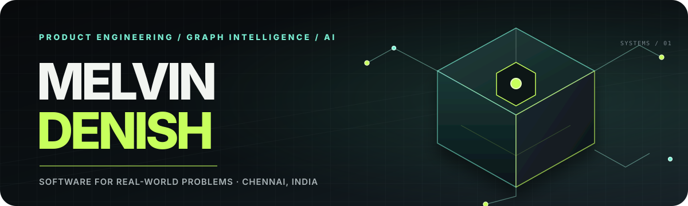

  

<h1 align="center">Hey, I’m Melvin.</h1>

  <strong>Turning complex problems into software that feels simple.</strong> 
  Computer Science undergraduate · Anna University · Chennai, India

  <a href="https://melvin-denish-portfolio.vercel.app">Portfolio</a> &nbsp;·&nbsp;
  <a href="https://www.linkedin.com/in/melvin-denish-lawrance-705356400/">LinkedIn</a> &nbsp;·&nbsp;
  <a href="mailto:lmelvindenish@gmail.com">Email</a>

I build at the intersection of **product engineering, graph intelligence, and applied AI**. I like understanding the real workflow first, then connecting interface, backend, and data into software people can trust and use.

Currently exploring **machine learning, real-time data, and agentic AI**. Open to internships, collaborations, and ambitious problems.

## Selected work

### [Sentinel-G](https://github.com/MelvinDenish/SME_Fraud_Detection) · [Live demo](https://sentinel-g-theta.vercel.app)
Graph-powered fraud analysis for SME financial statements, combining graph patterns, deterministic rules, and ML detectors with an explainable evidence trail.

`Python` · `FastAPI` · `React` · `Neo4j` · `LightGBM`

### [PRISM](https://github.com/MelvinDenish/PRISM) · [Live demo](https://prismofficial.vercel.app)
A placement-preparation platform with mentor discovery, live sessions, AI interview practice, shared coding rooms, and progress tracking.

`React` · `Express` · `MongoDB` · `Socket.IO` · `LiveKit`

### [Pre-Delinquency Intervention Engine](https://github.com/MelvinDenish/PreDelinquencyEngine)
A real-time early-risk platform built with a team for **Barclays Hack-O-Hire 2026**, where we finished **runner-up**.

`Kafka` · `Flink` · `FastAPI` · `XGBoost`

### [Business Entity Resolution](https://github.com/MelvinDenish/amazon-ml-challenge-2026)
A Python pipeline for the **Amazon ML Challenge 2026**. Team Bedrock recorded a **0.98674 leaderboard score**.

`Python` · `Machine learning` · `Entity resolution` · `Data pipelines`

## Recognition

| Result | Event |
| --- | --- |
| Runner-up | Barclays Hack-O-Hire 2026 |
| 4th overall · 1st in the Neo4j track | HACKHAZARDS ’26 |
| 9.4 / 10 CGPA | B.E. Computer Science & Engineering · 2024–2028 |

## Toolbox

`React` `TypeScript` `Node.js` `Express` `Python` `FastAPI` `PyTorch` `Kafka` `Neo4j` `PostgreSQL` `MongoDB` `Docker`

More projects: [CoolHaven](https://github.com/MelvinDenish/CoolHaven) · [Accountancy website concept](https://melvin-denish-portfolio.vercel.app/accountancy-concept.html)

If you’re building something useful and want a hands-on teammate, [let’s talk](mailto:lmelvindenish@gmail.com).
